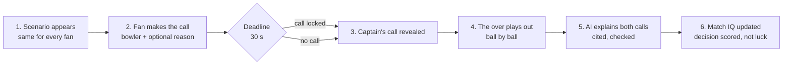
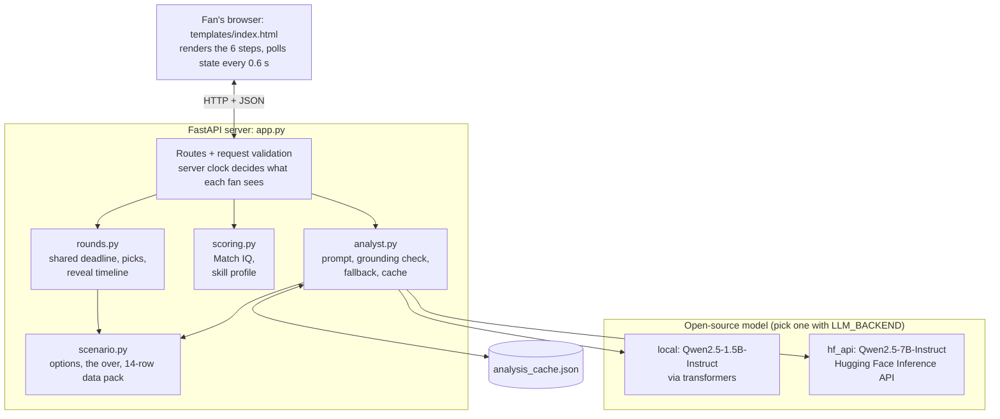

# Called It

**Don't just watch the game. Lead it.**

Called It is an AI-powered decision simulator for live cricket, built as a Dream11 experience. At a match-deciding moment, the fan becomes the captain for 30 seconds. They make the call, the real captain makes theirs, the over plays out, and an open-source AI model explains both decisions using only real match data. Every call builds the fan's **Match IQ**, which scores the quality of the decision, never the luck of the result.


| Play Captain | The over | AI Match Analyst | My Match IQ |
| --- | --- | --- | --- |
|  |  |  |  |

## Contents

- [The fan problem](#the-fan-problem)
- [Workflow](#workflow)
- [Architecture](#architecture)
- [Run it locally](#run-it-locally)
- [Deploy it](#deploy-it)
- [Scoring](#scoring-match-iq)
- [Tests](#tests)
- [Project layout](#project-layout)

## The fan problem

During a live match, fans argue with the TV about who should bowl, then the captain does something else and the moment passes. Nobody tells them whether their instinct was good, why the captain chose differently, or whether they're getting better at reading the game. Polls never close the loop, and chatbots give the fan nothing at stake.

Called It gives fans three things:

| Part | What the fan does | What it solves |
| --- | --- | --- |
| **Play Captain** | Makes the tactical call under a shared 30-second deadline | No stake in the moment |
| **AI Match Analyst** | Reads why each choice made sense and what it risked | No explanation |
| **My Match IQ** | Sees a score and a profile of their decision style | No feedback, no way to improve |

This version runs one scenario end to end, done properly: Australia need 32 off 18, and India must choose who bowls the 18th over.

## Workflow

The fan's journey through one round:



Four rules shape every step:

1. **Same scenario, same deadline for everyone.** A vote cast after seeing the captain's choice is hindsight, so late picks are kept but never scored.
2. **Judge the decision, not the result.** One over is mostly luck; the result scores zero points.
3. **The AI only says what the data supports.** Every number it writes is checked against the data pack before a fan sees it.
4. **Admit what is unknown.** The bowler who didn't bowl never had an over, so the AI never guesses how it would have gone.

## Architecture



**The server decides, the browser displays.** Time, the pick rules, the captain's choice, scoring and the AI all live on the server. The browser only sends what the fan did and draws what comes back.

| Module | Its one job |
| --- | --- |
| `app.py` | HTTP routes; wires the modules together; starts loading the model at startup |
| `called_it/scenario.py` | The match situation, four bowlers, six balls and the 14-row data pack (D1–D14) |
| `called_it/rounds.py` | Rounds, the shared deadline, picks, locks, and which facts each fan may see when |
| `called_it/scoring.py` | Match IQ points, skill profile, strengths and watch-outs |
| `called_it/analyst.py` | Model backends, prompts, citation tidying, grounding check, fallback, prefetch and cache |
| `templates/index.html` | Everything the fan sees |

**Phases are computed, never stored.** A round holds a single `deadline_at` timestamp. Each request compares the server's clock with it to work out the phase, so there is no background timer to fail and every fan sees the same phase at the same moment.

| Server time | Phase | What the fan may see |
| --- | --- | --- |
| 0–30 s | `open` | Scenario, options, countdown. `captain_choice` is `null` |
| 30–32 s | `closed` | Their locked call and the fan split |
| 32–35 s | `reveal` | The captain's choice, for the first time |
| 35–42.5 s | `playing` | One more ball every 1.5 s |
| 42.5 s on | `done` | The over's result (D14), AI analysis, Match IQ |

## Run it locally

Requires Python 3.10 or newer.

```bash
git clone https://github.com/thejasvini-292004/called-it.git
cd called-it
python3 -m venv .venv
source .venv/bin/activate              # Windows: .venv\Scripts\activate
pip install -r requirements-local.txt  # includes the model runtime (PyTorch)
uvicorn app:app --reload
```

Open http://127.0.0.1:8000. The first start downloads Qwen/Qwen2.5-1.5B-Instruct (about 3 GB) from the Hugging Face Hub in the background.

No download? Use the Hugging Face API instead:

```bash
pip install -r requirements.txt
LLM_BACKEND=hf_api HF_TOKEN=hf_yourtoken uvicorn app:app --reload
```

Or with no model at all (verified template analysis): `LLM_BACKEND=template uvicorn app:app --reload`.

## Deploy it

A 3 GB model doesn't fit on free hosting tiers, so the cloud deployment runs the same app with the model served by Hugging Face (`LLM_BACKEND=hf_api`). The deployed app installs only `requirements.txt` (no PyTorch), so it builds in about a minute.

### Render (free, deploys from GitHub)

1. Create a free Hugging Face token: huggingface.co, then **Settings → Access Tokens → Create new token** (type "Read" is enough; make sure it can call Inference Providers).
2. Push this repo to GitHub.
3. On [render.com](https://render.com), sign in with GitHub and choose **New → Blueprint**, then pick this repository. Render reads `render.yaml`.
4. When asked for `HF_TOKEN`, paste your token, then click **Apply**.
5. After the build, open the `.onrender.com` URL. Check `/api/health`: it should report `"backend": "hf_api"`.

Every push to `main` redeploys automatically. On the free plan the app sleeps after 15 minutes without visits, and the first visit after that takes about a minute to wake it.

If analyses always fall back to the template, the chosen model may not be served for your account. Open the model's page on Hugging Face, check the **Inference Providers** panel, and set `HF_MODEL` on Render to a model that is served there.

### Docker (any host)

```bash
docker build -t called-it .
docker run -p 8000:8000 -e LLM_BACKEND=hf_api -e HF_TOKEN=hf_yourtoken called-it
```

To run the open-source model inside the container instead (needs about 6 GB of RAM), build with `--build-arg LOCAL_MODEL=1` and run with `-e LLM_BACKEND=local`. This also works on Hugging Face Spaces (Docker Space, free 16 GB CPU), where the app should listen on port 7860: add `-e PORT=7860`, or set `PORT=7860` in the Space's variables.

## Scoring (Match IQ)

| Part | Points | Why |
| --- | --- | --- |
| Called before the deadline | 10 | Rewards committing under the same pressure as the captain |
| Situation read | 0–20 | How well the pick suits this over on the data: Bumrah 20, Kuldeep 13, Arshdeep 11, Hardik 6 |
| Reason fits the data | 5 | The stated reason must be true for that bowler |
| Same call as the captain | 15 | Agreement with an expert matters, but isn't most of the score |
| Result of the over | 0 | One over is mostly luck |

Late or missing calls score 0. Example: Kuldeep with "Matchup edge" scores 10 + 13 + 5 + 0 = 28, taking Match IQ from 612 to 640.

## Tests

```bash
pip install -r requirements-dev.txt
pytest -q
```

The 13 tests use a fake clock and a fake model, so they need no download and run in about a second. They cover the deadline and lock rules, that nothing leaks early, scoring, rejection of invented statistics and fake citations, fallback when the model fails, background prefetch, shared jobs, the disk cache, and the full API flow. GitHub Actions runs them on every push (`.github/workflows/tests.yml`).

## Project layout

```
app.py                     FastAPI app and routes
called_it/scenario.py      the scenario, options, the over and the data pack
called_it/rounds.py        server-side rounds, deadline, reveal timeline
called_it/scoring.py       Match IQ scoring and decision-profile insights
called_it/analyst.py       Hugging Face model backends, prompts, grounding check, cache
templates/index.html       the fan-facing web app
tests/test_called_it.py    test suite
warm_cache.py              pre-generates every analysis for an instant demo
requirements.txt           web app only (cloud deploys)
requirements-local.txt     + PyTorch and transformers to run the model locally
requirements-dev.txt       + pytest
Dockerfile, render.yaml    deployment
docs/screenshots/          images used in this README
```

## Data note

The fixture, scores and player statistics are illustrative sample values written for this prototype, not official records. In production, `scenario.py` would be fed by a live match feed and a stats provider. Rounds are held in memory, so restarting the server clears them.
